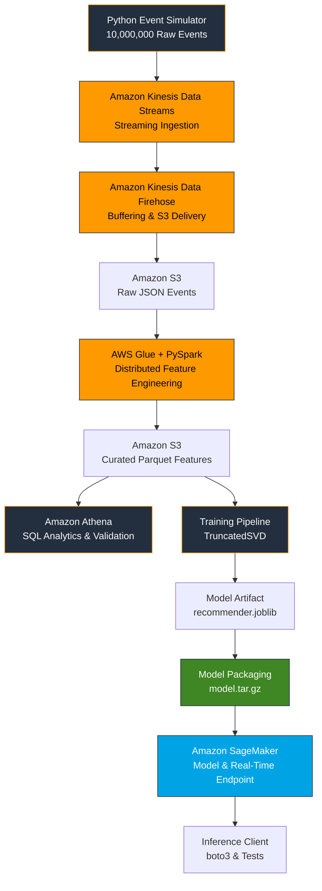

# Real-Time E-Commerce Recommendation & Streaming ML Architecture

A Terraform-managed AWS data engineering and MLOps platform built around **10,000,000 simulated raw e-commerce events**, streaming ingestion, distributed feature engineering, collaborative filtering, and SageMaker model deployment.

The platform streams user interactions through **Amazon Kinesis Data Streams and Amazon Kinesis Data Firehose**, stores raw events in Amazon S3, and processes them using **AWS Glue and PySpark**. The resulting datasets support a personalized recommendation model built with **TruncatedSVD**, packaged for SageMaker inference, and deployed through Terraform-managed AWS infrastructure.

The project combines streaming ingestion, distributed batch feature engineering, model training, artifact packaging, and synchronous cloud inference. Kinesis supports continuous event ingestion, while Glue processes the accumulated data through Spark jobs rather than continuously updating features for each incoming event.

## Architecture & Data Flow



## Data Flow

### 1. Event Generation — Python

The event simulator generates **10,000,000 simulated raw e-commerce interaction events** representing user behavior, including product views, cart additions, and purchases.

The simulator sends events into the streaming ingestion infrastructure using a user-based partition key.

### 2. Streaming Ingestion — Amazon Kinesis Data Streams

Kinesis Data Streams receives events and provides the streaming layer between event generation and downstream delivery.

The stream is configured with eight shards to support partitioned ingestion. Using `user_id` as the partition key maps events from the same user to the same shard while the partition-key mapping remains unchanged.

Kinesis Data Streams and Firehose have distinct responsibilities: Data Streams ingests and retains records, while Firehose handles downstream delivery.

### 3. Buffered Delivery — Amazon Kinesis Data Firehose

Kinesis Data Firehose consumes the stream and delivers records to Amazon S3.

The delivery configuration includes:

- Buffering and batching before S3 delivery
- GZIP compression
- Record-delimiter processing for newline-delimited JSON
- Date-based S3 prefixes
- Terraform-managed delivery configuration

The resulting raw events are stored in S3 for downstream processing.

### 4. Distributed Feature Engineering — AWS Glue & PySpark

The AWS Glue Spark job in `src/etl/feature_pipeline.py` processes raw JSON events and generates curated feature datasets.

The pipeline performs operations such as:

- Reading raw events from S3
- Validating records and handling malformed or incomplete data
- Applying implicit-feedback weights to behavioral interactions
- Aggregating user-product interactions
- Generating user-level behavioral features
- Applying Spark optimizations, including Adaptive Query Execution where configured
- Writing curated datasets as compressed Parquet to S3

The curated datasets provide a more compact analytical representation of the raw event stream.

This stage uses distributed Spark processing, but it is job-based rather than continuous per-event stream processing.

### 5. Analytical Access — Amazon Athena

Amazon Athena supports SQL queries over curated Parquet datasets stored in S3.

The feature datasets can be registered as queryable tables, including `default.user_features` and `default.interaction_features`, where those names match the deployed Glue Data Catalog configuration.

Athena provides a serverless SQL layer for inspecting processed data, validating schemas, and analyzing feature-engineering output.

### 6. Recommendation Model Training — TruncatedSVD

The training pipeline in `src/training/train.py` consumes curated interaction data and constructs a sparse user-item interaction matrix.

The model uses **TruncatedSVD** to factorize the matrix into a lower-dimensional representation. These latent factors are used to estimate preference scores for candidate products.

The pipeline includes temporal evaluation logic and a global popularity baseline for comparison.

The trained model is serialized to:

`models/recommender.joblib`

### 7. Model Evaluation and Packaging

Model evaluation is implemented in `src/models/evaluate_metrics.py`.

The evaluation workflow validates the serialized model and compares recommendation performance against a global popularity baseline. Actual performance metrics should be reported only when confirmed by the evaluation output.

The deployment script, `src/deployment/package_model.py`, packages the model and custom inference handler into a SageMaker-compatible archive:

`build/model.tar.gz`

The archive contains the model and inference code required to load the artifact and generate recommendations in the serving environment.

### 8. Cloud Deployment — Amazon SageMaker

Terraform provisions the SageMaker model, endpoint configuration, and real-time inference endpoint through `infrastructure/sagemaker.tf`.

The hosted inference handler loads the packaged model, processes incoming requests, generates recommendation scores, and filters previously interacted-with products where supported by the stored model data.

The endpoint provides synchronous inference: a client submits a request and receives a response without waiting for a new training run.

This does not, by itself, guarantee that recommendations immediately reflect the latest incoming events. That depends on how the serving system accesses and refreshes interaction data and features.

### 9. Local and Cloud Inference Testing

The project separates local inference testing from cloud integration testing:

- `src/inference/test_inference.py` tests the local inference path.
- `src/inference/test_endpoint.py` sends requests to the deployed SageMaker endpoint using `boto3`.

This separation helps distinguish local inference correctness from successful cloud deployment and endpoint integration.

---

## Technology Stack

| Technology | Purpose |
|---|---|
| Terraform | Infrastructure as Code and AWS resource provisioning |
| Amazon Kinesis Data Streams | Streaming ingestion and partitioned event handling |
| Amazon Kinesis Data Firehose | Buffering, compression, and S3 delivery |
| Amazon S3 | Raw event storage, curated datasets, and model artifacts |
| AWS Glue | Managed Spark ETL execution |
| PySpark | Distributed transformation and feature engineering |
| Amazon Athena | Serverless SQL analysis of curated datasets |
| scikit-learn | TruncatedSVD model training and recommendation scoring |
| SciPy | Sparse user-item interaction matrices |
| Amazon SageMaker | Hosted model inference |
| boto3 | AWS SDK and endpoint integration testing |
| AWS IAM | Service roles and permissions |
| Amazon CloudWatch | Service monitoring where configured |
| Python | Event simulation, training, inference, and testing |

## Infrastructure as Code

Terraform manages the AWS resources required for the streaming and machine-learning pipeline. The configurations are organized under `infrastructure/`.

### Storage — `s3.tf` and `features.tf`

Define the S3 storage layer for raw events, curated features, and model artifacts, along with associated feature-data resources.

### Streaming — `kinesis.tf` and `firehose.tf`

Separate streaming ingestion from delivery:

- `kinesis.tf` manages Kinesis Data Streams resources and associated configuration.
- `firehose.tf` manages Firehose delivery to S3, including buffering, compression, and record-delivery settings.

### Data Processing — `glue.tf`

Provisions AWS Glue resources used to run the PySpark feature-engineering job.

### Security — `iam.tf`

Defines service roles and permissions required by the streaming, processing, and model-serving components.

### Model Serving — `sagemaker.tf`

Provisions the SageMaker model and endpoint resources used to serve the packaged recommendation model.

### Configuration and Monitoring

Additional configuration files support resource naming, outputs, variables, tagging, monitoring, and environment configuration.

Terraform makes the infrastructure reproducible rather than relying entirely on manually created AWS resources.

## Machine Learning Design

### Collaborative Filtering

The recommendation system learns latent representations from user-product interaction data.

A simplified interaction matrix looks like this:

| User | Product A | Product B | Product C |
|---|---:|---:|---:|
| User 1 | 5 | 0 | 1 |
| User 2 | 0 | 3 | 5 |
| User 3 | 1 | 0 | 5 |

Higher values indicate stronger observed engagement, while zero represents the absence of an aggregated interaction in this illustrative matrix.

TruncatedSVD factorizes the matrix into lower-dimensional representations used to estimate preference scores for candidate products.

### Implicit Feedback Weighting

The feature pipeline assigns weights to behavioral events according to their intended strength of engagement.

| Interaction | Weight |
|---|---:|
| Product view | 1 |
| Cart addition | 3 |
| Purchase | 5 |
| Cart removal | -1 |

These are heuristic preference signals rather than calibrated probabilities of purchase.

### Temporal Evaluation

The evaluation workflow uses temporal splitting so the model is evaluated against interactions occurring after the information available during training.

```text
Earlier interactions → Training
Latest interaction   → Evaluation
```

This helps reduce future-information leakage compared with randomly splitting interactions across time.

### Popularity Baseline

The collaborative-filtering model is evaluated against a global popularity baseline. This helps determine whether personalization adds value beyond recommending products that are popular across the dataset.

Actual Precision@K, Recall@K, or other performance metrics should be included only when supported by evaluation results.

---

## Testing Strategy

### Local Inference Testing

Tests model loading, input parsing, recommendation generation, and output formatting without requiring an active SageMaker endpoint.

Run from the repository root:

```bash
python src/inference/test_inference.py
```

### Cloud Integration Testing

Invokes the deployed SageMaker endpoint using `boto3` to validate the client-to-endpoint request and response path.

Run from the repository root:

```bash
python src/inference/test_endpoint.py
```

The AWS credentials and permissions used by the test must allow invocation of the endpoint.

---

## Project Structure

```text
recommendation-streaming-platform/
│
├── build/
│   └── model.tar.gz
│
├── infrastructure/
│   ├── features.tf
│   ├── firehose.tf
│   ├── glue.tf
│   ├── iam.tf
│   ├── kinesis.tf
│   ├── locals.tf
│   ├── main.tf
│   ├── monitoring.tf
│   ├── outputs.tf
│   ├── s3.tf
│   ├── sagemaker.tf
│   └── variables.tf
│
├── models/
│   └── recommender.joblib
│
├── src/
│   ├── deployment/
│   │   └── package_model.py
│   │
│   ├── etl/
│   │   └── feature_pipeline.py
│   │
│   ├── inference/
│   │   ├── __init__.py
│   │   ├── inference.py
│   │   ├── test_endpoint.py
│   │   └── test_inference.py
│   │
│   ├── models/
│   │   └── evaluate_metrics.py
│   │
│   ├── simulator/
│   │   ├── event_generator.py
│   │   └── requirements.txt
│   │
│   └── training/
│       └── train.py
│
├── .gitignore
├── README.md
└── requirements.txt
```

---

## Deployment & Execution

### 1. Configure AWS Access

Configure AWS credentials and select the intended region. Verify that the identity has the permissions required to provision and operate the resources.

### 2. Initialize and Validate Terraform

From the repository root:

```bash
cd infrastructure
terraform init
terraform validate
terraform plan
```

Review the planned resources and costs before deployment.

### 3. Provision Infrastructure

```bash
terraform apply
```

Ensure that the streaming infrastructure is ready before running the simulator.

### 4. Generate Streaming Events

From the repository root:

```bash
python src/simulator/event_generator.py
```

Install the simulator's dependencies from `src/simulator/requirements.txt` if they are separate from the root requirements.

The workload targets 10,000,000 raw events. Actual counts should be confirmed from the simulator output and delivered data.

### 5. Run the Glue Feature Pipeline

After raw event data has been delivered to S3, start the configured Glue job through the AWS Console or CLI.

For example, if the deployed job name is `recommendation-streaming-platform-dev-feature-pipeline`:

```bash
aws glue start-job-run \
  --job-name recommendation-streaming-platform-dev-feature-pipeline
```

Wait for the job to finish successfully before querying the curated datasets or training the model.

### 6. Validate the Curated Data

Use Athena to inspect the registered tables and confirm that the curated datasets contain the expected columns and records.

Verify the Glue output paths and table schemas before model training.

### 7. Train and Evaluate the Model

From the repository root:

```bash
python src/training/train.py
python src/models/evaluate_metrics.py
```

Confirm that training produces `models/recommender.joblib` and that evaluation completes successfully.

### 8. Package the Model

```bash
python src/deployment/package_model.py
```

This should produce `build/model.tar.gz`, assuming the packaging script's prerequisites are satisfied.

### 9. Deploy or Update the Model

Ensure the packaged artifact is available at the S3 location expected by the Terraform configuration. Then run:

```bash
cd infrastructure
terraform plan
terraform apply
```

Verify that the SageMaker model references the correct artifact and that Terraform applies the intended model or endpoint update.

### 10. Test Inference

From the repository root:

```bash
python src/inference/test_inference.py
python src/inference/test_endpoint.py
```

The first command tests local inference; the second requires a deployed, available SageMaker endpoint and appropriate AWS permissions.

---

## Engineering Highlights

- **10 million raw events:** A large simulated interaction workload used to exercise the streaming pipeline.
- **Separated streaming responsibilities:** Kinesis Data Streams handles ingestion, while Firehose handles buffering and delivery to S3.
- **Distributed feature engineering:** AWS Glue and PySpark transform raw events into curated datasets.
- **Analytical data access:** Athena supports SQL-based inspection and validation of processed Parquet data.
- **Collaborative filtering:** TruncatedSVD generates personalized recommendation scores from sparse user-item interactions.
- **Temporal evaluation:** Time-aware splitting helps reduce future-information leakage.
- **Baseline benchmarking:** A popularity-based recommender provides a reference for evaluating personalization.
- **Artifact-based deployment:** Model serialization and packaging separate training from inference.
- **Infrastructure as Code:** Terraform manages the AWS resources required by the platform.
- **Independent testing:** Local inference and live cloud integration are validated separately.

## Key Takeaways

This project demonstrates hands-on experience with:

- AWS data engineering and streaming architecture
- Kinesis Data Streams and Kinesis Data Firehose
- S3 storage and data delivery
- AWS Glue, PySpark, and distributed ETL
- Parquet feature datasets and Athena
- Sparse matrices and collaborative filtering
- TruncatedSVD model training and evaluation
- SageMaker model packaging and hosted inference
- Terraform-based AWS infrastructure
- IAM permissions and cloud integration testing

The central engineering objective is to demonstrate how **10,000,000 raw behavioral events can flow through a cloud-based streaming and feature-engineering pipeline into a deployable recommendation system**, with distinct ingestion, delivery, processing, training, packaging, and serving components.
