# Real-Time E-Commerce Recommendation & Streaming ML Architecture

A Terraform-managed AWS MLOps platform demonstrating **real-time event ingestion, distributed feature engineering, collaborative filtering, model packaging, and automated SageMaker deployment**.

The project implements an end-to-end recommendation pipeline in which simulated e-commerce interactions are streamed through **Amazon Kinesis Data Firehose**, persisted to **Amazon S3**, transformed with **AWS Glue and PySpark**, and used to train a collaborative filtering recommendation model using **TruncatedSVD**.

The resulting model artifact is packaged into a SageMaker-compatible model bundle and deployed to an **Amazon SageMaker real-time inference endpoint** using Terraform. The project also includes separate local inference tests and cloud integration tests to validate the model-serving pipeline.

---

## Architecture & Data Flow

```mermaid
graph LR

    A[Event Simulator] --> B[Amazon Kinesis<br/>Data Firehose]
    B --> C[Amazon S3<br/>Raw Events]

    C --> D[AWS Glue<br/>PySpark ETL]
    D --> E[Amazon S3<br/>Curated Interactions]

    E --> F[Training Pipeline<br/>TruncatedSVD]
    F --> G[Model Artifact<br/>recommender.joblib]

    G --> H[Model Packaging<br/>model.tar.gz]
    H --> I[Amazon SageMaker<br/>Model]
    I --> J[SageMaker<br/>Real-Time Endpoint]

    J --> K[Inference Client<br/>boto3 / Tests]

    style B fill:#FF9900,stroke:#232F3E,stroke-width:2px,color:#000
    style D fill:#FF9900,stroke:#232F3E,stroke-width:2px,color:#000
    style F fill:#232F3E,stroke:#FF9900,stroke-width:2px,color:#fff
    style H fill:#3F8624,stroke:#232F3E,stroke-width:2px,color:#fff
    style J fill:#00A4E4,stroke:#232F3E,stroke-width:2px,color:#fff
```



### Data Flow

1. **Event Simulation & Streaming Ingestion — Amazon Kinesis & Firehose**

   The project generates simulated e-commerce interaction events representing user behavior such as product views, cart additions, and purchases.

   Events are streamed through **Amazon Kinesis Data Firehose** and delivered to an S3 raw-data bucket.

2. **Distributed Feature Engineering — AWS Glue & PySpark**

   The AWS Glue PySpark job in `feature_pipeline.py` processes the raw interaction events.

   The pipeline:

   * Reads raw JSON event data
   * Validates incoming records
   * Applies interaction weighting
   * Aggregates user-product interactions
   * Builds behavioral features
   * Writes curated datasets to S3 as compressed Parquet

3. **Model Training — TruncatedSVD**

   The training pipeline in `train.py` consumes the curated interaction data and constructs a sparse user-item interaction matrix.

   The recommendation model uses **TruncatedSVD** for matrix factorization.

   The training process uses a temporal split designed to prevent future interactions from leaking into the training set. For each user, earlier interactions are used for training while the user's latest interaction is reserved for evaluation.

4. **Model Packaging — SageMaker Artifact**

   The trained recommendation model is serialized as:

   ```text
   recommender.joblib
   ```

   The deployment script `package_model.py` packages the model together with the custom inference handler into:

   ```text
   model.tar.gz
   ```

   The resulting artifact is structured for Amazon SageMaker model hosting.

5. **Cloud Serving — Amazon SageMaker**

   Terraform provisions the SageMaker model and real-time inference endpoint.

   The packaged model is loaded by the custom inference handler and exposed through the SageMaker endpoint.

6. **Local & Cloud Validation**

   The project separates local model/inference validation from cloud integration testing.

   `test_inference.py` validates the inference pipeline locally, while `test_endpoint.py` sends requests to the deployed SageMaker endpoint using `boto3`.

---

## Technology Stack

| Technology                       | Purpose                                               |
| -------------------------------- | ----------------------------------------------------- |
| **Terraform**                    | Infrastructure as Code and AWS resource orchestration |
| **Amazon Kinesis Data Firehose** | Streaming event ingestion                             |
| **Amazon S3**                    | Raw event storage and curated feature storage         |
| **AWS Glue**                     | Managed ETL and distributed data processing           |
| **PySpark**                      | Distributed feature engineering                       |
| **scikit-learn**                 | TruncatedSVD collaborative filtering                  |
| **SciPy**                        | Sparse user-item interaction matrices                 |
| **Amazon SageMaker**             | Model hosting and real-time inference                 |
| **boto3**                        | AWS SDK for Python                                    |
| **AWS IAM**                      | Service authorization and execution roles             |
| **Python**                       | Simulation, ETL, training, inference, and testing     |

---

## Infrastructure as Code

Terraform manages the AWS infrastructure required for the data and machine-learning pipeline.

### Storage

`s3.tf` and `features.tf` define the S3-based storage layer used for:

* Raw streaming events
* Curated interaction data
* Feature datasets
* Model artifacts

### Streaming

`kinesis.tf` and `firehose.tf` define the streaming ingestion infrastructure used to deliver simulated events into S3.

### Data Processing

`glue.tf` provisions the AWS Glue resources required for the PySpark feature-engineering pipeline.

### IAM

`iam.tf` defines the service roles and permissions required by AWS services throughout the pipeline.

### SageMaker

`sagemaker.tf` provisions the SageMaker model and endpoint infrastructure required for real-time inference.

### Configuration & Governance

Additional Terraform files provide:

* Audit configuration
* Resource naming
* Tags
* Outputs
* Variables
* Environment configuration

The infrastructure can therefore be reproduced through Terraform rather than relying exclusively on manually configured AWS resources.

---

## Machine Learning Design

### Collaborative Filtering

The recommendation system models relationships between users and products using implicit behavioral signals.

The interaction matrix follows the general structure:

```text
              Product A   Product B   Product C
User 1            5           0           1
User 2            0           3           5
User 3            1           0           5
```

Higher values represent stronger engagement with a product.

The resulting sparse matrix is factorized using **TruncatedSVD** to learn lower-dimensional representations of the interaction data.

---

### Implicit Feedback Weighting

Instead of treating every interaction equally, the pipeline assigns different weights according to behavioral strength:

| Interaction | Weight |
| ----------- | -----: |
| View        |      1 |
| Cart Add    |      3 |
| Purchase    |      5 |

This provides the recommendation model with a stronger signal for interactions that indicate greater user intent.

---

### Temporal Train/Test Split

The evaluation process uses a temporal split rather than randomly dividing interactions.

For each user:

```text
Earlier interactions → Training data
Latest interaction   → Test data
```

This prevents the model from training on interactions that occur after the event being evaluated.

The approach better represents a recommendation scenario in which the system must generate recommendations using information available before a user's future interaction.

---

### Popularity Baseline

Model performance is compared against a simple global popularity recommendation baseline.

This provides a reference point for determining whether the learned collaborative-filtering model provides additional signal beyond recommending globally popular products.

---

## Model Evaluation

Model evaluation is separated into `evaluate_metrics.py`.

The evaluation process treats the serialized model artifact as the object being validated rather than relying exclusively on the in-memory training object.

This mirrors a production-oriented MLOps workflow:

```text
Training
   ↓
Model Artifact
   ↓
Validation
   ↓
Packaging
   ↓
Deployment
   ↓
Inference
```

Separating artifact evaluation from training helps validate the actual model that will be packaged and deployed.

---

## Model Packaging

The deployment process separates the trained model from the training environment.

The packaging pipeline produces:

```text
recommender.joblib
        ↓
package_model.py
        ↓
model.tar.gz
        ↓
SageMaker Model
        ↓
SageMaker Endpoint
```

The model bundle contains the serialized recommendation model and the custom inference code required to load the artifact and generate recommendations.

This allows the same model artifact to be tested locally before being deployed to SageMaker.

---

## Testing Strategy

The project uses two complementary testing paths.

### Local Inference Testing

`test_inference.py` validates the inference code locally.

This allows the following to be tested without an active AWS endpoint:

* Model loading
* Input parsing
* Recommendation generation
* Output formatting
* Inference logic

Run:

```bash
python src/inference/test_inference.py
```

### Cloud Integration Testing

`test_endpoint.py` sends inference requests to the deployed SageMaker endpoint.

This validates the complete cloud serving path:

```text
Client
  ↓
boto3
  ↓
SageMaker Endpoint
  ↓
Inference Handler
  ↓
Model Artifact
  ↓
Recommendations
```

Run:

```bash
python src/inference/test_endpoint.py
```

This separates **local model validation** from **cloud integration testing**.

---

## Project Structure

```text
real-time-recommendation-streaming-ml/
│
├── build/
│
├── data/
│
├── infrastructure/
│   ├── audit.tf
│   ├── features.tf
│   ├── firehose.tf
│   ├── glue.tf
│   ├── iam.tf
│   ├── kinesis.tf
│   ├── locals.tf
│   ├── main.tf
│   ├── outputs.tf
│   ├── s3.tf
│   ├── sagemaker.tf
│   └── variables.tf
│
├── models/
│   └── recommender.joblib
│
├── src/
│   ├── deployment/
│   │   └── package_model.py
│   │
│   ├── etl/
│   │   └── feature_pipeline.py
│   │
│   ├── inference/
│   │   ├── __init__.py
│   │   ├── inference.py
│   │   ├── test_endpoint.py
│   │   └── test_inference.py
│   │
│   ├── models/
│   │   └── evaluate_metrics.py
│   │
│   ├── simulator/
│   │   ├── event_generator.py
│   │   └── requirements.txt
│   │
│   └── training/
│       └── train.py
│
├── .gitignore
├── README.md
├── requirements.txt
└── terraform.tfstate
```

> **Note:** Local virtual environments, generated datasets, build caches, model artifacts, and Terraform state should generally be excluded from version control through `.gitignore`. The exact repository contents may therefore differ from the structure shown above.

---

## Deployment & Testing

### 1. Clone the Repository

```bash
git clone https://github.com/YOUR_USERNAME/real-time-recommendation-streaming-ml.git

cd real-time-recommendation-streaming-ml
```

### 2. Initialize Terraform

Navigate to the Terraform configuration:

```bash
cd infrastructure
```

Initialize Terraform:

```bash
terraform init
```

Review the planned infrastructure:

```bash
terraform plan
```

Deploy the AWS infrastructure:

```bash
terraform apply
```

### 3. Generate Streaming Events

Run the event simulator according to the configuration in `src/simulator/`.

The simulator generates user interaction events representing:

* Product views
* Cart additions
* Purchases

These events are sent through the streaming ingestion pipeline and delivered to S3.

### 4. Run the Feature Pipeline

After the required raw event data is available in S3, run the AWS Glue PySpark feature-engineering job.

The pipeline processes raw interaction events and produces curated Parquet interaction data for model training.

### 5. Train the Recommendation Model

From the project root:

```bash
python src/training/train.py
```

This produces the serialized recommendation model:

```text
models/recommender.joblib
```

### 6. Package the Model

Run:

```bash
python src/deployment/package_model.py
```

This creates the SageMaker-compatible deployment artifact:

```text
build/model.tar.gz
```

### 7. Test Inference Locally

Run:

```bash
python src/inference/test_inference.py
```

This validates the inference handler and model artifact without requiring a live SageMaker endpoint.

### 8. Test the Live SageMaker Endpoint

After the endpoint has been deployed and is available:

```bash
python src/inference/test_endpoint.py
```

This sends a test request to the deployed endpoint using `boto3`.

---

## Engineering Highlights

### End-to-End Streaming ML Architecture

Connects event generation, streaming ingestion, cloud storage, distributed feature engineering, model training, artifact packaging, deployment, and inference into a single cloud architecture.

### Distributed Feature Engineering

Uses AWS Glue and PySpark to transform raw interaction events into curated machine-learning features.

### Collaborative Filtering

Implements matrix factorization using TruncatedSVD and sparse user-item interaction matrices.

### Temporal Evaluation

Uses temporal train/test splitting to reduce the risk of future-information leakage during model evaluation.

### Baseline Benchmarking

Compares recommendation performance against a simple global popularity baseline.

### Artifact-Based Deployment

Separates the trained model artifact from the training environment and packages it for independent serving.

### Infrastructure as Code

Uses Terraform to provision and configure the AWS infrastructure required by the data and ML pipeline.

### Local vs. Cloud Testing

Separates local inference testing from live SageMaker integration testing to validate both model behavior and cloud deployment.

---

## Key Takeaways

This project demonstrates practical experience with:

* **AWS Data Engineering**
* **Real-Time Event Streaming**
* **Amazon Kinesis Data Firehose**
* **Amazon S3**
* **AWS Glue**
* **PySpark**
* **Distributed Feature Engineering**
* **Collaborative Filtering**
* **Matrix Factorization**
* **TruncatedSVD**
* **Sparse Matrices**
* **Amazon SageMaker**
* **Custom Model Inference**
* **Model Packaging**
* **Terraform / Infrastructure as Code**
* **AWS IAM**
* **boto3**
* **ML Model Evaluation**
* **Cloud Integration Testing**

The central engineering objective is to demonstrate how **streaming behavioral data can move through a cloud-native data pipeline into a deployable recommendation system**, while maintaining reproducible infrastructure and clear separation between data ingestion, feature engineering, model training, artifact validation, deployment, and production inference.
